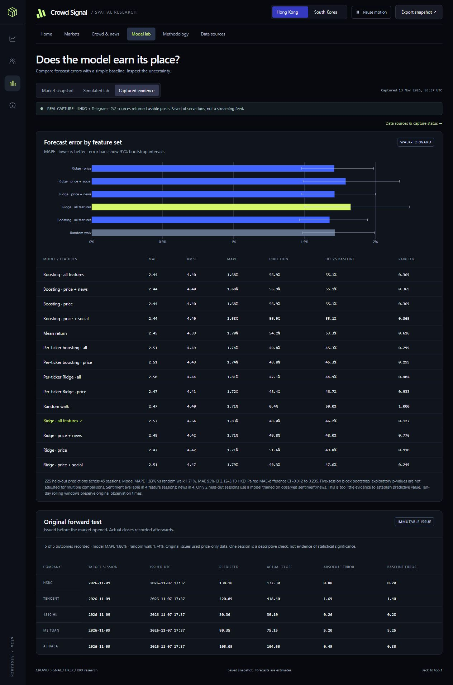

# Crowd Signal

A reproducible Python pipeline for social sentiment, news, price levels and next-session equity estimates across Hong Kong and South Korea.

[Open the research report](https://gokhale-atharva.github.io/crowd-signal-research/) · [Public source repository](https://github.com/gokhale-atharva/crowd-signal-research) · [Portable report](reports/index.html) · [Source evidence](docs/feasibility/capture_summary.json)

## Submission snapshot 13 November 2026

Both exchanges have inspected LIHKG and Telegram captures. The current ten-day window has **23 company-linked social records across all ten selected companies**. The retained news snapshot contains **505 Exa articles**. One message can match several tickers. Telegram includes publisher/broker research and reposts; these small samples are not representative retail sentiment.

Daily prices end **12 November 2026**, the latest completed session at capture. Sentiment/news observations first collected on9 November are retained with their original availability times. Both updated pooled Ridge forecasts now use the all-feature model. There are only **four sentiment/news feature sessions and two sentiment-informed held-out sessions**; predictive value is not established.

**The genuine forward check is complete.** The original pre-open issues targeted9 November. Their actual closes and errors are in [predictions/results.csv](predictions/results.csv). Original issue files and pre-open commit history are unchanged. Those original predictions were price-only, and the random walk had lower overall error in both exchanges.



## Architecture

```mermaid
flowchart LR
 YAML[Exchange YAML] --> CLI[Typer CLI]
 CLI --> Capture[Apify social / Exa news / daily market bars]
 Capture --> Cache[Ignored raw responses and run manifests]
 Cache --> Normalize[UTC / relevance / dedupe / first observations]
 Normalize --> Extract[Schema constrained LLM or labelled lexicon]
 Extract --> Signals[Sentiment / explicit positions / price levels]
 Signals --> Features[Causal ten day rolling features]
 Features --> Models[Expanding window models / baselines / uncertainty]
 Models --> Report[Portable multipage HTML / Motion / Three.js]
 Models --> Issue[Immutable pre open issue]
 Issue --> Outcome[Append only genuine close evaluation]
 Replay[Marked offline sample bundle] --> Normalize
```



## Quick start

Python 3.11–3.14. Tested in a fresh isolated Windows/Python 3.12 environment, including a full keyless replay and66 passing tests. From a fresh clone:

```sh
python -m venv .venv
# Activate Windows: .venv\Scripts\activate
# Activate macOS/Linux: source .venv/bin/activate
python -m pip install -e ".[dev]"
crowd-signal replay
```

Open reports/index.html. The entire folder should be retained for multipage navigation. reports/hkex.html and reports/krx.html are self-contained exports. No CDN is required.

Replay uses explicitly synthetic bars/posts/news to demonstrate the complete software pipeline without network access or API keys. Synthetic results are never represented as real trading performance. The included Makefile provides setup, replay, live, test and report targets.

## Live collection in five steps

1. Copy.env.example to ignored.env. Set APIFY_TOKEN and EXA_API_KEY privately. LLM_API_KEY is optional.
2. Inspect actor metadata, permissions, pricing and current provider credit. Run crowd-signal doctor --strict.
3. Review the exchange YAML, public Telegram channels and the capped source inputs in docs/inputs. A source only counts after actual timestamped relevant bodies are inspected.
4. Run crowd-signal run-all --exchange ALL --mode live. Completed raw responses are cached; incomplete paid runs are not blindly relaunched.
5. Inspect coverage and causal availability, then run crowd-signal report. Commit the exported reports to publish through GitHub Pages. Use predict only after refreshing the latest closed session and before the target open; use evaluate after a genuine target close.

Inspected probes can be reused without another paid Apify launch:

```sh
crowd-signal import-probes --exchange HKEX --selections data/raw/feasibility/submission_2026-11-13/HKEX_capture_inputs.json
crowd-signal analyse --exchange HKEX --mode live
crowd-signal train --exchange HKEX --mode live
crowd-signal report
```

The local selection manifest and live raw caches stay private; they are not prerequisites for the committed keyless replay. Partial imports require --allow-partial and remain labelled.

## Universe and source decisions

Current HKEX: Tencent0700.HK, Alibaba9988.HK, Meituan3690.HK, TVB0511.HK and HSBC0005.HK. Current KRX: Samsung005930.KS, SK Hynix000660.KS, NAVER035420.KS, Kakao035720.KS and LG Energy Solution373220.KS.

TVB replaces Xiaomi in the current watchlist because Xiaomi had no relevant social match in the refreshed ten-day window. The original prompt expressly permits editing the suggested set when data is thin. TVB has an inspected financial LIHKG post. The original Xiaomi prediction and actual result remain preserved in the9 November forward test. This watchlist change is not used to rewrite or improve that original test.

Both exchanges use LIHKG + Telegram at the user's later explicit request. That changes the original prompt's KRX-specific source selection; it is recorded in docs/source_decisions.md. Both platforms have relevant records per exchange, but not every company has a match on both platforms.

| Source | Actor actually used | Contract |
|---|---|---|
| LIHKG | claude_code_reviewer/lihkg-scraper-en | One bounded keyword or thread, body text and source timestamp; titles/quotes alone and irrelevant device/index replies excluded |
| Telegram | scrapesage/telegram-scraper | One reviewed public channel per launch; dated relevant messages; no media |
| Exa news | Exa search and contents API | English/local queries, news category,10/90day publication filters, retrieval time retained |

Primary Telegram channels: theartoftrade, h_zonstock and meritz_research. Supplementary inspected searches with zero/irrelevant results are not counted as source coverage. Optional actors/naver_board code is included but not active or deployed.

Every probe is limited to20 items, at most$0.10 requested event charge and a short timeout. Observed Apify run usage across inspected manifests is **$0.109**; this is not a final invoice or a cap on all compute/proxy charges. The general collector reserves at most$2 requested event charges per exchange. Exa and LLM costs are separate. No plan upgrade or recurring billing was enabled.

## Methodology

- All timestamps become UTC while the original timezone is preserved. Exchange calendars supply holidays, close cutoffs and after-close assignment. Retrieval/engagement times are never backdated.
- Ten-day rolling social/news features use only bodies published within the window and observed before each feature close. Retained first versions prevent later edits or engagement counts from rewriting history. Old publication dates alone do not establish past availability.
- Exact/near deduplication, obvious-spam checks and language-script hints are conservative heuristics. Null engagement/follower fields stay null when unavailable.
- Sentiment weights are (1+log1p(likes+reposts+0.1*views))*sqrt(1+log1p(followers)), with a three-day exponential half-life. Log weights reduce the influence of viral posts; decay favors recent observations.
- Schema-constrained configurable LLM extraction is implemented. Current scores use the permitted multilingual lexicon fallback, labelled lexicon-v1. It is not a calibrated sentiment model. Explicit positions require first-person statements and identifiable authors; optimism is not ownership. No explicit position authors were found in the current sample.
- Support/resistance combines confirmed swing clusters, pivots, round numbers and stated crowd levels. The nearest two levels per side include heuristic strength and method labels.
- Model target is next-session log return, converted back to price. Features include lagged returns, volatility, RSI, volume and causally available sentiment/news signals. Fixed pooled/per-ticker Ridge and gradient-boosting variants are compared with random walk and mean return:14 comparisons.
- Validation uses expanding windows, shared test dates across tickers and45 held-out sessions. Models refit every five sessions and when newly labelled sentiment information becomes available. No random split, leaderboard model selection or held-out hyperparameter tuning is used.
- MAE/RMSE/MAPE, directional accuracy, win rate, five-session block-bootstrap intervals and paired comparisons are reported. Cross-model multiple testing is not corrected. Forecast bands are empirical residual bands, not guaranteed calibrated intervals.
- Four TVB vendor bars report opens outside their high/low ranges. Their displayed/level ranges use the minimal envelope containing reported open/high/low/close. Original provider high/low are preserved, repairs are flagged, and model closes and volumes are unchanged. Raw responses remain unmodified. The source page discloses this normalization.

## Results and limits

Updated all-feature Ridge held-out MAPE: HKEX1.825% versus random walk1.715%; KRX2.766% versus2.576%. Most held-out sessions predate available sentiment history. Only two held-out sessions involve training on observed sentiment/news. This does not demonstrate useful predictive power.

| Original9 November forward issue | Assets | Model MAPE | Random-walk MAPE | Assets beating random walk |
|---|---:|---:|---:|---:|
| HKEX, original watchlist |5|1.856%|1.737%|2|
| KRX |5|2.374%|1.879%|2|

One target session is a descriptive check, not statistical evidence. The issue files were committed7 November before9 November opened, and actual closes were recorded13 November. The new13 November estimates were generated after that day's open, so they are labelled research estimates and are not claimed as pre-open issued forecasts. No past result or issue was fabricated or overwritten.

Longer contemporaneous collection, more independent dates, corporate-action audits, transaction costs and stability analysis are needed before stronger claims. This software is research, not a trading system.

## Reproduce and verify

```sh
python -m pytest
python -m ruff check src tests scripts actors
crowd-signal replay
```

The clean reviewer environment passed67 tests, lint and the full336-post offline replay. Tests include availability cutoffs, future-data perturbation, rolling-window expiry, source acceptance/relevance, retained imports, model folds, immutable evaluation and page links. Dependency warnings are documented, not treated as completed live source tests. requirements-dev.lock is the earlier workstation snapshot, not a cross-platform hash lock; pyproject.toml was freshly installed and verified on Python 3.12.

## Project structure and delivery

src/crowd_signal contains typed agents and orchestration. data/sample contains labelled simulated inputs. tests contains contracts and causal regression checks. predictions contains original issues and append-only results. reports contains the complete portable site. docs contains source evidence, design references, results and screenshots. .github/workflows/pages.yml publishes only the saved report; it never receives provider API keys.

Keys, raw captures, live normalized caches and virtual environments stay excluded from Git. The repository is public at the user's13 November request. SUBMISSION.md and SUBMISSION_EMAIL.md supply the handoff details with token placeholders only. No email or API key has been sent.

The earlier chatgpt.site URL remains an older snapshot because its host-managed Git authentication is currently rejected. The linked GitHub Pages report is the current submission deployment. Both hosts serve saved reports; neither streams data or runs collection from the browser.


The freshly verified dependency versions are recorded in requirements-reviewer.lock. Original prediction JSON is unchanged in Git. Windows worktrees may use CRLF while Git stores LF; docs/prediction_integrity.json records both byte hashes and confirms identical normalized issue content.
