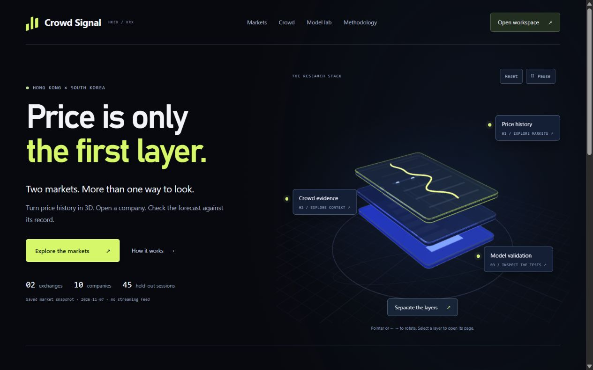
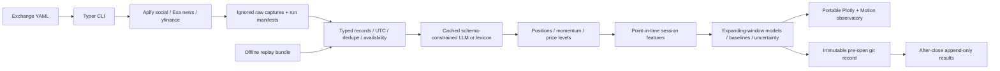

# Crowd Signal

A Python research pipeline for five Hong Kong and five Korean stocks, with a multi-page research site and an animated 3D landing page. It collects social data through Apify, news through Exa,
and public daily OHLCV through yfinance; extracts multilingual sentiment and explicit author
positions; computes price levels; and tests next-session models through time.

[Hosted research workspace](https://crowd-signal-research-desk.chandrashekhargokh96.chatgpt.site)
· [Portable HTML](reports/index.html) · [Source decisions](docs/source_decisions.md)
· [Design references](docs/design_references.md) · [Task brief](docs/task_brief.md)

The software and keyless workflows are implemented. Real public-price runs for both exchanges
completed through **6 November 2026**. Live social/news collection has **not** been certified:
no Apify, Exa or LLM keys were supplied, Telegram channels still need verification, and the
included private Naver actor needs deployment and a capped acceptance run. The report makes
this visible. Simulated lab is a separate mode: its prices, posts and news are generated fixtures.



## Architecture



Small agents live in `src/crowd_signal/agents`; the same orchestrator handles both exchanges.
Configuration is `src/crowd_signal/config/exchanges.yaml`. Public raw captures, author handles,
API keys, processed caches and virtual environments are ignored by Git.

## Quick start

Python 3.11+; tested on Windows / Python 3.13.5. In a fresh environment:

```sh
python -m venv .venv
# Activate: Windows .venv\Scripts\activate; macOS/Linux source .venv/bin/activate
python -m pip install -e ".[dev]"
crowd-signal replay
```

Replay reads committed `data/sample/bundle.json`, 2,800 synthetic bars, 336 synthetic social
posts and 305 synthetic news records, then executes cleaning, sentiment, levels, feature
construction, all model variants, uncertainty and reports **without network or keys**.
It takes roughly a minute depending on hardware. The small `posts.json` fixture remains a
separate parser smoke input. Generated fixture data is never issued as a real forecast.

Open `reports/index.html` by double-click, or use the hosted link. The landing page has a
Motion entrance and an interactive Three.js stack with separate/reassemble, reset, keyboard
rotation and pause controls. Its primary workspace link opens a new tab.

Research has its own pages: `markets.html`, ten `company-*.html` pages, `community.html`,
`validation.html` and `methodology.html`. Company cards and table entries open company pages.
Page links preserve the exchange and evidence mode. The landing and legacy `hkex.html` /
`krx.html` exports embed their runtimes; the other pages share files in `reports/assets`.
Keep the exported folder together for offline navigation. Nothing depends on a CDN.

The hosted site is a saved research report, not a server that executes Python or refreshes prices.

A real keyless workflow downloads current public prices and runs both exchanges:

```sh
crowd-signal run-all --exchange ALL --mode price_only
```

## Live setup in five steps

1. Copy `.env.example` to ignored `.env`; fill `APIFY_TOKEN` and `EXA_API_KEY`.
   An OpenAI-compatible `LLM_API_KEY` is optional; without it the multilingual lexicon runs.
2. Run `crowd-signal feasibility --query lihkg`; inspect Store metadata and billing.
   Run the capped `probe` commands documented in `docs/source_decisions.md`.
3. Select relevant permitted public Telegram investor channels in each exchange YAML.
   Run `crowd-signal deploy-actor` for the supplied private Naver board actor if needed,
   inspect its build/robots/endpoint behavior, and set its returned actor ID in KRX config.
4. Run `crowd-signal run-all --exchange ALL --mode live`. The collector requires all
   configured sources and rejects a ticker/source with no usable timestamped body text.
5. Commit source changes, run `crowd-signal predict --exchange HKEX --mode live` and KRX
   before their next open. After the target session closes run `crowd-signal evaluate
   --exchange HKEX` and KRX, then `crowd-signal report`.

Do not treat Step 0 as passed until actual capped runs are inspected. The current source
adapters are implemented against reviewed schemas; their live suitability remains unverified.

## Actor IDs, inputs and costs

| Source | Actor | Input / current state |
| --- | --- | --- |
| HK LIHKG | `claude_code_reviewer/lihkg-scraper-en` | One alias per search, last 10 days, max20; one bounded thread hydration if output is listing-only. Not run. |
| HK/KR Telegram | `scrapesage/telegram-scraper` | One configured public channel and alias, dated window, max20, no media. Channels/run verification pending. |
| KR Naver discussion board | Included `actors/naver_board` | Private Python actor; ticker board, max20 posts, max3 pages, UTC-convertible timestamps. Not deployed. |

Actual actors used in authenticated runs: **none**. A Store listing is not source verification.
Store search from the earlier discovery is preserved in `docs/source_decisions.md`.

Every launch supplies `max_items<=20`, `max_total_charge_usd<=0.10`, and a timeout.
The collector divides a default **$2 requested event-charge budget per exchange workflow**
across alias searches and potential hydration; it refuses caps below $0.01. Two exchanges
reserve at most $4 in event-charge caps before separate feasibility tests. Caches skip
completed runs. Paid actor launches are never automatically retried. Metadata/dataset reads
may retry. Unknown pricing is refused except for an actor owned by the authenticated account,
which is restricted to 256MB and a short timeout. That owned compute actor is **not** protected
by an event-charge cap: compute, proxy, storage, build and rental charges can be additional.
Check remaining free credit before running. No actual cost per100 usable posts can be stated
without a real run; manifests record run IDs and observed charge metadata for that calculation.
Exa/LLM billing is separate; default Exa usage is at most 40 dated searches for ten assets
(EN/local ×10/90days), up to12 results each. Pricing is provider-controlled.

## Methodology

- All publications normalize to UTC and preserve source timezone. Actual XHKG/XKRX calendars
  supply holidays and session times. Session assignment tests include after-close/weekend cases.
- Exact normalized hashes and near-duplicate similarity remove repeated content; short/link-only,
  repeated-token and obvious promotional spam is excluded. Author identifiers are hashed.
- Structured LLM batches validate a strict schema and exact IDs, cache by provider/model/content,
  and fall back to a clearly labelled English/Chinese/Korean lexicon on failure. Explicit long/
  short statements are counted per known author using their latest position; opinion alone does
  not imply ownership. Unknown-author position posts are counted separately.
- Sentiment weights are `(1+log1p(likes+reposts+0.1*views))*sqrt(1+log1p(followers))`, multiplied
  by an exponential three-day half-life. Log scaling dampens viral outliers; decay emphasizes
  recent views. Missing metrics remain null in storage and contribute zero only to the formula.
  These are heuristic choices, not estimated causal effects.
- Signals cover ten days; Exa also retrieves90days of dated history. **Publication time is not
  proof of historical availability.** Features use max(publication, observed/retrieved time).
  Today’s retrieved articles and engagement are never backdated. Thus a fresh live collection
  cannot honestly create90days of historical news features. Accumulate daily snapshots or replay
  contemporaneous captures to build that history.
- Features include lagged returns,10-session volatility, RSI14, volume z-score, available social/
  news sentiment, volume, momentum and bull/bear ratio. Current OHLCV is consumed after official
  close, then forecasts are issued before the following open. Labels are next-session log returns.
- Ridge (alpha10, standardized) and small sklearn gradient boosting use fixed settings, pooled
  ticker effects and per-ticker variants. There are14 comparisons including all ablations and
  random-walk/mean-return baselines. Expanding windows share held-out dates across tickers;
  last45 labelled sessions are evaluated, refitting every5. No random split or held-out tuning.
- Forecast model is predetermined pooled Ridge: price-only if historical sentiment is absent,
  otherwise all features. The leaderboard does not select the winner. Empirical95% held-out
  log-residual bands are illustrative and are not guaranteed calibrated intervals.
- MAE/RMSE/MAPE, exact-sign directional accuracy, and error-win rate against random walk (ties
  count half) have paired circular five-session block-bootstrap intervals. Tickers stay together.
  Paired centered-bootstrap p-values are exploratory, unadjusted for multiple model comparisons.
  A random walk predicts zero change, so exact-sign accuracy is the fraction of unchanged closes.
- Levels combine confirmed swing clusters on up to252 sessions, classic last-bar pivots, round
  numbers and explicit crowd levels. Nearest two supports below and resistances above are shown.
  Strength is a heuristic score, **not a probability**; hover a level to inspect methods.

## Results and honest limitations

Real public prices through 2026-11-06;225 held-out predictions /45 sessions per exchange.
Price metrics aggregate five assets; MAE/RMSE are in local currency and scale differs by ticker.

| Exchange / fixed model | MAE | RMSE | MAPE | Direction | Random-walk MAPE |
| --- | ---: | ---: | ---: | ---: | ---: |
| HKEX / Ridge price | 2.567 HKD | 4.394 HKD | 1.861% |49.3% |1.862% |
| KRX / Ridge price |17,285.537 KRW |37,577.451 KRW |2.721% |48.4% |2.561% |

HK Ridge minus random-walk MAE95% CI is **[-0.070,0.069] HKD** (p≈0.945), consistent with no
improvement. KRX Ridge is worse: differenceCI **[263.454,3453.209] KRW**, exploratory p≈0.042.
That is not evidence of useful predictive power. Social/news ablations coincide in real mode
because those histories have not been collected. **Whether sentiment adds value is untested.**
The lab’s independently generated fixture returns test software behavior, not market efficacy.
Ten days of social observations is far too short for confident inference. Longer contemporaneous
captures, more dates/tickers, corporate-action handling, robust normalized metrics, transaction
costs, stability checks and corrected statistical comparisons would be needed for stronger claims.

The genuine forward target is **Monday9 November2026**, with results pending until its actual
close. Prediction issuance files live under `predictions/`; hashes bind inputs and source commit.
They cannot be overwritten. Evaluation appends idempotently to `predictions/results.csv` and
never changes the original record. No future outcome is invented.

## How to reproduce

```sh
crowd-signal doctor
crowd-signal replay
python -m pytest
python -m ruff check src tests scripts actors
crowd-signal run-all --exchange ALL --mode price_only
crowd-signal report
```

Live collection and price-only runs export hashed normalized replay bundles under
`data/raw/<capture-date>/replay/<exchange>_<mode>/bundle.json`. Copy a bundle privately, then
`crowd-signal replay --sample PATH/bundle.json`. Replay does not access the network or call an
LLM; it uses the deterministic lexicon and checks hashes. Input integrity is not provider
attestation. Raw files remain ignored and are never uploaded into the report.

`requirements-dev.lock` records installed project/dev dependency versions for Windows/Python3.13.5;
it is a tested version snapshot, not a hash-verified universal lock. Use pyproject for other
platforms. This workstation’s environment reuses host packages; clean-environment installation
is documented but was not independently verified here.

## Project structure

`src/crowd_signal`: CLI, typed contracts, storage, session alignment, orchestrator and agents.
`actors/naver_board`: bounded private Apify actor source and input schema.
`data/sample`: explicitly synthetic portable replay inputs.
`tests`: contracts, source billing guards, causal features, model folds, parsing, dedupe and forecasts.
`reports`: committed HTML exports. `docs/img`: reviewed screenshots.
`docs`: original brief, research/source decisions, design tokens and third-party notices.

## Next steps requiring external state

Supply private API keys; verify channels and two actual social sources per exchange; deploy/test
Naver or select another allowed source if its endpoint/robots disallows collection. Accumulate
historically available observations. Evaluate the recorded forward forecasts after9November closes.
Private source repository: [gokhale-atharva/crowd-signal-research](https://github.com/gokhale-atharva/crowd-signal-research).
It contains source, reports and original Git history, excluding credentials, raw captures and caches.
No keys or submission email have been sent.

## Sentiment capture views

The Sentiment tab keeps saved prices visible when no social observations exist. Use its
**Try simulated sentiment** button for a working, clearly labelled example. **Data sources**
shows which captures exist and how to connect the local pipeline. The website does not accept
provider keys or launch collection. A missing score is null, while an observed neutral score is zero.

A newly retrieved set of recent posts can be displayed retrospectively by publication day using
captured engagement. That chart is labelled and is never fed backwards into historical model
features. Repeat live collections preserve first-seen text, engagement and availability times;
those retained observations allow causal history to accumulate. Incomplete collection/analysis/
training invalidates stale downstream output so it cannot be exported as a completed report.

Before live work run `crowd-signal doctor --strict` or `crowd-signal doctor --json`. Run-all checks
all selected exchanges before the first paid job and lists missing keys, actors and channels.
See [remaining tasks](docs/pending_tasks.md) for credentials, source certification
and the target-session outcome that cannot be completed with the current external state.
