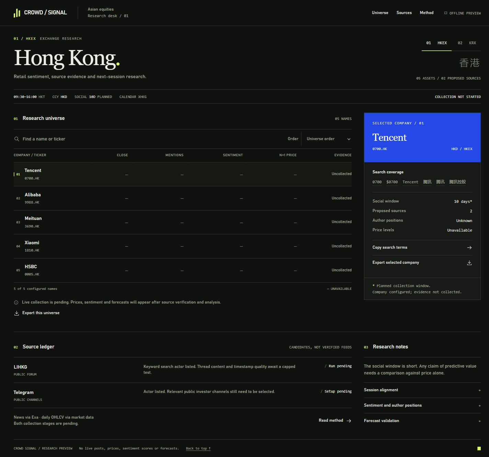
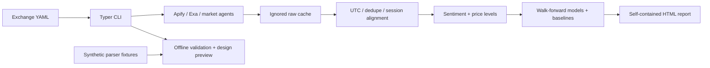

# Crowd Signal

An evidence-first retail sentiment research pipeline for **five HKEX assets and
five KRX assets**, with a portable report and explicit uncertainty.

**Current checkpoint: milestone 1 scaffold + public Step 0 discovery.** Live source
tests need credentials. Sentiment extraction, model training, statistical results,
full analytical replay and a genuine live forward test are not implemented yet.
The HTML is an interactive design preview with intentional empty values.

## Overview

The intended pipeline collects public social posts through Apify and news through
Exa, aligns them to exchange sessions, extracts structured signals, compares simple
next-session models against a random walk, and exports self-contained reports.
This checkpoint is runnable without API keys and does not fabricate financial data.

[Open the report preview](reports/index.html) · [Source decisions](docs/source_decisions.md)
· [Design system](docs/design_system.md) · [Full task brief](docs/task_brief.md)



## Architecture



The lower offline path works at this checkpoint. The full collection-to-model path
is the staged architecture for subsequent milestones.

## Quick start

Python 3.11+ is required. From this repository root, Windows PowerShell:

```powershell
python -m venv .venv
.venv\Scripts\python -m pip install -e ".[dev]"
.venv\Scripts\crowd-signal replay
```

On macOS/Linux, replace `.venv\Scripts\python` with `.venv/bin/python` and
`.venv\Scripts\crowd-signal` with `.venv/bin/crowd-signal`. Activate the virtual
environment to use the shorter commands below. `uv pip install -e ".[dev]"` also works.

Open `reports/index.html` by double-click. There are no CDN assets, font downloads,
API calls, or separate frontend build steps. The preview supports exchange
switching, multilingual search, sorting, a persistent company inspector, search-term
copying, research-note disclosures, and CSV export for a universe or selected company.

```powershell
crowd-signal doctor
python -m pytest
python -m ruff check src tests
```

`replay` currently validates four explicitly synthetic post fixtures and renders
the preview. It does **not** compute sentiment or backtest results. The full raw-data
analytical replay is a milestone 5 deliverable. The fixtures use `example.invalid`
URLs and contain no real author identities.

`requirements-dev.lock` records the tested core/dev dependency versions on Windows
with Python 3.13.5. For that version snapshot, install with
`python -m pip install -r requirements-dev.lock` inside a clean virtual environment.
It is a version snapshot, not a hash-verified cross-platform lock for future models.

## Live setup / Step 0

These five commands prepare and inspect the first candidate; they do not claim a
completed live pipeline. Put real secrets only in the ignored local `.env` file.

```powershell
Copy-Item .env.example .env
# Edit .env locally to set APIFY_TOKEN and EXA_API_KEY.
crowd-signal doctor
crowd-signal feasibility
crowd-signal probe claude_code_reviewer/lihkg-scraper-en --input docs/inputs/lihkg_probe.json --output data/raw/feasibility/lihkg
crowd-signal collect --exchange HKEX
```

The final command intentionally exits with a milestone-2 readiness error until
source collection is implemented (or a missing-key error if credentials are absent).
Pending stages never produce successful empty research results.

## Actor IDs, inputs and costs

**Actor IDs used in actual runs: none.** Candidate listings are listed below.

| Candidate | Reviewed input | Free-tier metadata event cost / 100 |
| --- | --- | --- |
| [claude_code_reviewer/lihkg-scraper-en](https://apify.com/claude_code_reviewer/lihkg-scraper-en) | `docs/inputs/lihkg_probe.json` | $0.20 / 100 listings; separate start/detail/reply events |
| [scrapesage/telegram-scraper](https://apify.com/scrapesage/telegram-scraper) | `docs/inputs/telegram_probe.example.json` (channel placeholder) | $0.20 / 100 messages on the FREE tier |

Prices come from public Actor metadata inspected on 2026-11-07, not measured
run costs. Telegram's Store headline advertises a lower starting rate that does
not match its FREE-tier event price. See `docs/feasibility/candidate_metadata.json`.
The initial cap requests 20 items and $0.10 event charges per probe.
At those free-tier rates, five HKEX assets × 20 items from each candidate is about
$0.40 in result events, **excluding** any start/detail events, compute, proxy,
retries, channel metadata, repeated aliases, and Exa/LLM charges. A complete project
cost cannot be established until both sources and the KRX path are tested. No claim
is made that a live 10-day crawl fits the brief's approximate $5 account credit.
Cache all live responses; inspect the remaining account balance before running.

See [source decisions](docs/source_decisions.md) for supported parameters, pricing
qualifications, missing discussion-board coverage and source acceptance criteria.

## Methodology

Implemented foundations: validated config and Pydantic contracts; UTC normalization
with original timezone preservation; session assignment against supplied observed
dates; content hashes; null-versus-zero engagement; causal prediction contracts;
explicit readiness errors; read-only Store discovery; bounded actor-test tooling.

Planned analysis uses engagement weight
`(1 + log1p(likes + reposts + 0.1*views)) * sqrt(1 + log1p(followers))`, multiplied
by exponential age decay. This gives reactions more weight than passive views,
compresses highly popular posts, and downweights old observations. The decay half-life,
missing-data policy, dedupe, language scoring and historical-engagement limitations
will be documented and tested when the analysis milestone is implemented.

Planned n+1 target: next-session close log return converted to price. Expanding-window
evaluation will compare Ridge and a small gradient booster, pooled ticker effects
and per-ticker variants, against random walk, historical mean return and price-only
models. Ablations will distinguish social and news value. Report price MAE/RMSE/MAPE,
direction accuracy, baseline hit rate, paired bootstrap uncertainty and significance.
No random train/test split or future feature leakage is acceptable.

## Results and limitations

There are **no sentiment, model, accuracy or live-forward results yet**. The 10-day
social window in the brief is small; even after implementation, an apparent gain
may not be statistically significant. Synthetic fixtures are parser examples,
not validation evidence. Publication timestamps and present-day engagement do not
establish historical availability. The current session helper needs a caller-supplied
calendar; no exchange holiday calendar or market feed has been fetched yet.

Milestone 4 must add actual feature-level leakage tests. Current prediction tests
validate contract timing only. Milestone 7 must write and commit an immutable real
forecast before the target open, then record observed results after the close. A
past date, synthetic forecast or retrospective commit cannot count as a live test.

## How to reproduce

Install the package, run `doctor`, `replay` and the tests. Check the exported report
and `docs/feasibility/store_discovery.json`. Discovery is a read-only network command;
replay and tests do not require network or real credentials. Keep `.env` and
`data/raw/` untracked. For the actual pipeline milestones install `.[dev,pipeline]`.
Configuration lives in `src/crowd_signal/config/exchanges.yaml`; changing the universe
or source proposals does not require exchange-specific code.

## Project structure

```text
src/crowd_signal/
  config.py, models.py, sessions.py, feasibility.py
  cli.py, pipeline.py
  config/exchanges.yaml
  agents/collector.py, news.py, market.py
  agents/sentiment.py, levels.py, model.py, report.py
  templates/report.html
tests/                 configuration, contracts, session boundaries, CLI, offline, budgets
data/sample/           explicitly synthetic parser fixtures
docs/                  decisions, source research, inputs, design system, task brief
reports/               index + HKEX + KRX portable previews
```

## Next steps

1. Complete capped source probes, inspect fields and costs, and establish two
   reproducible HKEX sources. Implement collection, Exa and market data.
2. Extract sentiment and price levels; persist normalized stage artifacts.
3. Fit and validate models with ablations and feature-level leakage tests.
4. Connect the report to real signals/charts and implement full offline replay.
5. Validate two KRX sources through the same code path.
6. Issue a genuine pre-open forecast, commit it, and evaluate after close.

The brief requires checkpoint summaries and a git commit at each milestone.
See [submission status](SUBMISSION.md); this checkpoint is not a finished hiring submission.
